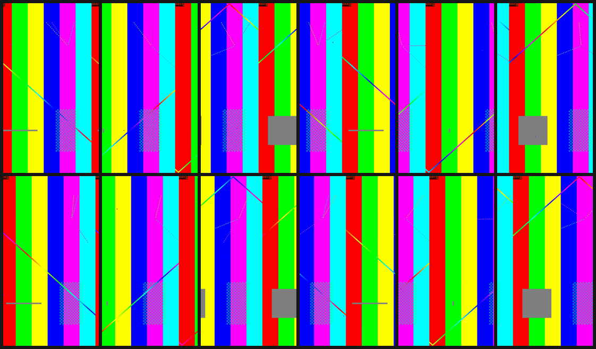

# reelqc

A QC gate for short-form video. Point it at a render and it checks format, loudness, black
frames, freezes, silence, and whether the first two seconds actually move. It prints a report,
writes JSON and a contact sheet, and exits **0 / 10 / 1** so a pipeline can ship, flag or block.

```
reelqc check render.mp4 --profile reel
```

## Why

I run AI video production for a social account with 9.4M followers. Generated and
automatically assembled video breaks in ways nobody sees until it is posted: a shot that
rendered black, a clip that ran short and froze on its last frame, a mix 10 dB too hot, a 4:5
export uploaded as a reel, a hook that opens on a dead frame.

In my production engines a render cannot ship until automated gates pass. The point is to
block bad renders before a person has to look at them, so human review is spent on taste, not
on catching black frames. `reelqc` is a clean, generic version of that gate that any pipeline,
agent or CI step can call.

## Checks

Defaults below are for the `reel` profile. A FAIL blocks; a WARN passes with exit 10.

| Check | What it measures | Default | Severity |
|---|---|---|---|
| `aspect` | display aspect ratio (rotation metadata applied) | 9:16, ±1 % | FAIL |
| `resolution` | pixel size | 1080x1920 | WARN (right shape, the platform rescales) |
| `fps` | average frame rate | 30 ± 0.5 | WARN |
| `codec` | video codec | h264 or hevc | FAIL |
| `pix_fmt` | pixel format | yuv420p | WARN |
| `audio` | an audio stream exists | required | FAIL |
| `duration` | container duration | 15–90 s | FAIL |
| `loudness` | EBU R128 integrated loudness (`ebur128`) | −14 LUFS ± 1.5 | FAIL |
| `true_peak` | EBU R128 true peak (`ebur128=peak=true`) | ≤ −1.0 dBTP | FAIL |
| `silence` | `silencedetect` below −50 dB | none longer than 2 s | WARN |
| `black` | `blackdetect`, pixel threshold 0.10 | none longer than 0.5 s | FAIL |
| `first_frame` | `blackdetect` span starting at t=0 | first frame not black (dead hook) | FAIL |
| `freeze` | `freezedetect`, −60 dB noise floor | none longer than 2 s | FAIL |
| `hook_motion` | mean abs frame difference over the first 2 s, 64x64 grey frames at 10 fps | ≥ 1.5 | WARN |

All four ffmpeg detectors run in a single decode pass. A 16 s 1080x1920 clip checks in about
a second on a laptop.

**How the hook threshold was set.** Downscaling with area averaging removes grain, and a fixed
10 fps sample keeps the number comparable across 24/30/60 fps sources. I measured 14 rendered
reels from my own pipeline: 4.2 to 29.7. A still frame with live film grain scores 0.6; a
slow push-in on a still (4.5 %/s) scores 1.2. 1.5 sits between "something moves" and "a
picture with a zoom on it". It is a WARN rather than a FAIL because a static hook can be a
deliberate creative choice.

### Profiles

| Profile | Size | Duration | Notes |
|---|---|---|---|
| `reel` | 1080x1920 (9:16) | 15–90 s | Instagram Reels |
| `short` | 1080x1920 (9:16) | 5–180 s | YouTube Shorts |
| `yt` | 1920x1080 (16:9) | 60–3600 s | long-form: freeze 5 s, silence 3 s |
| `square` | 1080x1080 (1:1) | 5–60 s | feed video |

Any threshold can be overridden: `--set KEY=VALUE` on the command line, keyword arguments in
Python. `reelqc profiles` prints every key.

## Install

Needs Python 3.9+ and `ffmpeg` / `ffprobe` on `PATH`. No Python dependencies.

```
pip install git+https://github.com/aayush0124/reel-qc
```

Or run it from a clone without installing: `python -m reelqc check video.mp4`.

## Usage

```
reelqc check render.mp4 --profile reel
reelqc check render.mp4 --profile yt --set lufs=-16 --set max_s=900
reelqc check render.mp4 --out qc/ --no-sheet
reelqc profiles
```

The report goes to stdout. `<name>.qc.json` and `<name>.sheet.png` (12 evenly spaced frames,
the first frame included) are written next to the video, or into `--out`.

### Exit codes

| Code | Meaning | Pipeline action |
|---|---|---|
| 0 | pass | ship |
| 10 | pass with warnings | ship, flag for a human look |
| 1 | fail | block |
| 2 | could not run (bad arguments, ffmpeg missing, unreadable file) | block |

### In CI (GitHub Actions)

CI treats every non-zero exit as a failure, so map 10 to a warning annotation:

```yaml
- name: Install ffmpeg + reelqc
  run: |
    sudo apt-get update && sudo apt-get install -y ffmpeg
    pip install git+https://github.com/aayush0124/reel-qc

- name: QC gate
  run: |
    set +e
    reelqc check out/render.mp4 --profile reel --out qc/
    code=$?
    if [ "$code" -eq 10 ]; then echo "::warning::reelqc passed with warnings"; exit 0; fi
    exit $code

- uses: actions/upload-artifact@v4
  if: always()
  with: { name: qc-report, path: qc/ }
```

### From Python

```python
from reelqc import check, format_report

report = check("render.mp4", profile="reel", sheet="render.sheet.png", lufs=-16)
print(format_report(report))
if report["exit_code"] == 1:
    failed = [c["check"] for c in report["checks"] if c["status"] == "FAIL"]
    raise SystemExit(f"blocked: {', '.join(failed)}")
```

`check()` returns the same dict that is written as JSON: settings used, media facts, raw
measurements (black/freeze/silence spans, LUFS, true peak, hook motion), one row per check,
verdict and exit code. It raises `QCError` when the check itself cannot run.

## Example

The passing test clip, from [`docs/example-report.txt`](docs/example-report.txt):

```
reelqc 0.1.0  tests/fixtures/pass.mp4  profile=reel
media: 1080x1920 30.00fps h264/yuv420p, audio aac, 16.00s

  PASS  aspect       9:16 (1080x1920), expected 9:16
  PASS  resolution   1080x1920, expected 1080x1920
  PASS  fps          30.00 fps, expected 30 +/-0.5
  PASS  codec        h264, allowed h264/hevc
  PASS  pix_fmt      yuv420p, expected yuv420p (8-bit 4:2:0 plays everywhere)
  PASS  audio        audio stream: aac
  PASS  duration     16.00s, window 15-90s
  PASS  loudness     -14.0 LUFS integrated, target -14 +/-1.5
  PASS  true_peak    -13.0 dBTP, max -1
  PASS  silence      silence > 2s: none
  PASS  black        black > 0.5s: none
  PASS  first_frame  first frame has picture
  PASS  freeze       frozen > 2s: none
  PASS  hook_motion  8.1 mean frame diff in first 2s, min 1.5

VERDICT: PASS (exit 0)
contact sheet: docs/pass.sheet.png
json: docs/pass.qc.json
```



A failing clip names the check and the time span:

```
  FAIL  black        black > 0.5s: 6.00-7.03s

VERDICT: FAIL (exit 1)
```

## Tests

```
python tests/test_reelqc.py
```

`tests/make_fixtures.py` generates nine 16 s clips with ffmpeg `lavfi` (`testsrc2` with a slow
pan, plus a `sine` tone measured at −14 LUFS), each with exactly one defect. A fixture passes
only if it gets the expected exit code, the defect lands on the expected check, and every other
check passes, so a clip that fails for the wrong reason is caught too.

```
  pass          exit  0  all PASS
  black_gap     exit  1  black=FAIL
  black_first   exit  1  first_frame=FAIL
  too_loud      exit  1  loudness=FAIL true_peak=FAIL
  no_audio      exit  1  audio=FAIL loudness=SKIP true_peak=SKIP silence=SKIP
  wrong_aspect  exit  1  aspect=FAIL resolution=WARN
  frozen        exit  1  freeze=FAIL
  silence       exit 10  silence=WARN
  static_hook   exit 10  hook_motion=WARN
ok    test_fixture_verdicts
ok    test_overrides
ok    test_cannot_run_is_exit_2
ok    test_contact_sheet
```

## Limits

- The thresholds are delivery defaults I use, not platform rules. Platforms change their specs;
  override them per job.
- `hook_motion` measures pixel change, not whether a hook is any good. It catches the dead
  open, not the boring one.
- `black` reads luma. An intentionally dark shot can trip it; lower `black_pix_th` for that job.

## Credits

Built with AI coding assistants; the system design, thresholds and QC rules are mine.

MIT licensed. Copyright (c) 2026 Aayush Paliwal.
