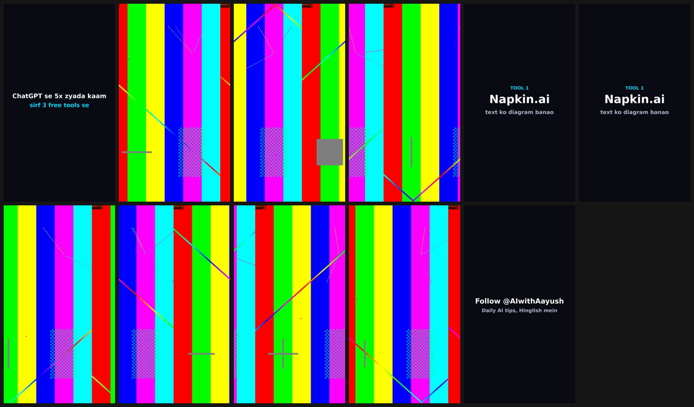

# reelqc audit: @AIwithAayush (AWA) reels

**Date:** 2026-10-03 · **Version audited:** 0.1.0 (`main` at `2526189`) · **Fixed in:** 0.2.0

## What was audited, and how

The question was which quality failures repeat when AWA reels go through the reelqc gate. There
are no historical QC logs to mine, so the evidence comes from controlled probe clips. Each clip
recreates one pattern from an AWA reel, and some carry a known defect. A gate does two jobs:
it must pass a good render and block a broken one. Every probe tests one of the two.

The AWA layout is inferred, not observed. The brand background (#0A0B14, "always use this,
never plain black"), the accent colours and the card style come from the AWA design system.
The reel structure (hook card, footage, held point card, end slate, voiceover muxed on last)
comes from the reel templates and the content plans, which call for 65–70 s news reels. I had
no real AWA render to test, so the dark-card findings assume AWA reels use brand cards the way
the carousels do.

## What the 0.1.0 gate did with AWA-style clips

| Probe | What a viewer sees | 0.1.0 verdict | Right verdict |
|---|---|---|---|
| Brand card with 80 px hook text, held 3 s | a normal on-brand card | FAIL: `black`, `freeze` | pass |
| End slate "Follow @AIwithAayush", 3 s | a normal end slate | FAIL: `black`, `freeze` | pass |
| Opens on brand card, hook fades in | a text-hook open | FAIL: `black`, `first_frame` | pass (static-hook WARN is fair) |
| Brand card with a pulsing accent | an animated card | FAIL: `black`, `freeze` | pass |
| 13 s of picture, 16 s voiceover | last frame frozen for 3 s | **PASS** | block |
| 16 s of picture, 13 s voiceover | 3 s of dead air | **PASS** | flag |
| Footage freezes 3 s, no grain | a stalled shot | FAIL: `freeze` | block |
| Same freeze, grain pass on top | a stalled shot | **PASS** | block |

The gate failed in both directions: it blocked good reels and passed broken ones.

## The three failures, ranked

Ranked by how often each hits an AWA reel and what it costs when it does.

### 1. The brand background reads as a black frame

- **What happens:** every brand card fails `black`, and a reel that opens on one fails
  `first_frame` as well.
- **Why it repeats:** `blackdetect` counts a pixel as black below luma ~38 (`pix_th` 0.10) and a
  frame as black when 98 % of its pixels are. #0A0B14 sits at luma ~26. A line of hook text
  covers 0.5–1.3 % of the frame (measured on the probes: 98.7–99.5 % of pixels below the
  threshold), so every card is "black". This hits every reel that shows a brand card.
- **Cost:** a gate that blocks every good reel gets overridden, and after that it catches
  nothing.
- **Fix:** a new `awa` profile with `black_pix_th=0.03` (luma ~22.6). True black (16) plus codec
  noise still trips it. The brand never uses pure black, so a black frame in an AWA reel is
  always a defect. The generic defaults are unchanged.
- **Tests:** `awa_cards` and `awa_open` pass under `awa`. `black_gap` and `black_first` still
  fail under `awa`, so the profile is tuned, not loosened.

### 2. Video and audio of different lengths ship with a clean PASS

- **What happens:** the container duration is the longest stream, and every detector only sees
  frames that exist. A voiceover 3 s longer than the edit passed all 14 checks while the
  platform showed a frozen last frame. A short voiceover passed with 3 s of dead air.
- **Why it repeats:** it happens whenever the voiceover is muxed onto a separately rendered
  timeline. The plans call for 65–70 s news reels while the Remotion reel template caps reels
  at 60 s, which is exactly this mismatch waiting to happen.
- **Cost:** a broken reel ships with no warning at all. This is the worst kind of gate failure.
- **Fix:** a new `av_length` check in every profile. It reads where each stream ends (start
  time plus duration). If the video ends more than 0.5 s before the audio, that is a FAIL,
  because the last frame holds. If the audio ends early, that is a WARN, matching how
  `silence` treats dead air. Black and freeze spans still run to the end of the container,
  because the platform keeps showing the last frame. A frozen tail can therefore show up in
  `freeze` as well, but `av_length` is the row that names the cause.
- **Tests:** `video_short` → FAIL, `audio_short` → WARN, plus `test_av_length_detail`. The
  `awa_overrun` fixture (a 2.2 s end slate, then a 2.6 s voiceover overrun) must fail on
  `av_length` alone. It caught a bug in my first version: the card test sampled a frame past
  the end of the picture, found nothing, and called the end slate a stalled shot.

### 3. A held brand card reads as a stalled shot

- **What happens:** a point card or end slate held over 2 s fails `freeze`. A pulsing accent on
  the card does not help; the change is too small for `freezedetect`'s −60 dB floor.
- **Why it repeats:** cards are static by design, and an end slate of about 3 s is standard.
  Fixing #1 alone still leaves these reels blocked.
- **Fix:** when `card_hold_max` is above 0, reelqc samples one frame from each freeze. If at
  least 90 % of its pixels are card background (`card_pix_th` 0.10), the freeze may hold up to
  `card_hold_max` seconds. Any other freeze still fails at 2 s. The setting is off in every
  profile except `awa`, which allows 5 s.
- **Tests:** `awa_cards` (two 3 s cards) passes under `awa`. `test_card_hold_limit` shows that a
  2.5 s limit fails it again, and that turning card holds on does not hide the `frozen`
  footage freeze.

## Found, not fixed

**A grain pass hides a stalled shot.** `freezedetect` needs frames that repeat. If a grain or
noise pass runs after an AI clip stalls, every frame differs and the 3 s stall passes. The weekend
cinematic AI reels are exposed to this. I did not fix it because the obvious fixes (downscale
first, or raise the noise floor) start reading a still talking head as frozen, and most AWA reels
are recorded on camera (the daily plans list an outfit for each). Tuning that safely needs a handful of real AWA renders: a few talking heads
and a few cinematic reels. Probe: `testsrc2` with `loop=loop=90:size=1:start=150,noise=alls=10:allf=t`.

**Also worth knowing:**

- A reel that opens on a text card always gets the `hook_motion` WARN. That is by design, but if
  most AWA reels open this way, the warning turns into noise.
- A card with a large cutout photo (as on the carousel cover and CTA slides) is below 90 % card
  background, so its freeze is judged as footage. Lower `card_share` if reel cards use photos.
- reelqc does not check text that runs off the frame. My first demo render had exactly that bug.

## Demo: one sample reel, before and after

`docs/awa-sample/make_sample.py` renders one AWA-style reel. It has a hook card that fades in,
footage, a "Napkin.ai" point card held 3.5 s, more footage, and a "Follow @AIwithAayush" end
slate held 3 s. Two versions: **as rendered**, a 27 s edit with a 30 s voiceover (the script
ran long), and **re-cut**, the same reel cut to 30 s.



| Render | 0.1.0, `reel` | 0.2.0, `awa` |
|---|---|---|
| As rendered | FAIL on `black`, `first_frame`, `freeze`. All three point at the cards; the frozen tail only appears folded into the end slate's freeze, and the cause is not named | FAIL on `av_length` ("video ends 3.00s before audio") and on `freeze`, because the end slate now sits on screen 6 s, past the 5 s card limit. One real defect: the first row is the cause, the second is what a viewer sees |
| Re-cut to 30 s | FAIL on the same three. Shipping it needs an override | WARN (exit 10): static text-card open only. Ships with a flag |

Full reports: [`awa_sample.before.txt`](awa-sample/awa_sample.before.txt),
[`awa_sample.after.txt`](awa-sample/awa_sample.after.txt),
[`awa_sample_fixed.before.txt`](awa-sample/awa_sample_fixed.before.txt),
[`awa_sample_fixed.after.txt`](awa-sample/awa_sample_fixed.after.txt).

To reproduce:

```
python docs/awa-sample/make_sample.py            # --font PATH on Windows/macOS
python -m reelqc check docs/awa-sample/awa_sample.mp4 --profile awa
python -m reelqc check docs/awa-sample/awa_sample_fixed.mp4 --profile awa
```

## What changed for existing users

- `av_length` is a new check in every profile. A file that previously passed can now fail if its
  streams differ by more than 0.5 s. Use `--set av_gap_max=…` to relax it.
- The JSON gains `media.video_end`, `media.audio_end` and four settings keys. Nothing was
  removed or renamed.
- `reel`, `short`, `yt` and `square` are otherwise unchanged: card holds are off, and the black
  threshold is still 0.10.
